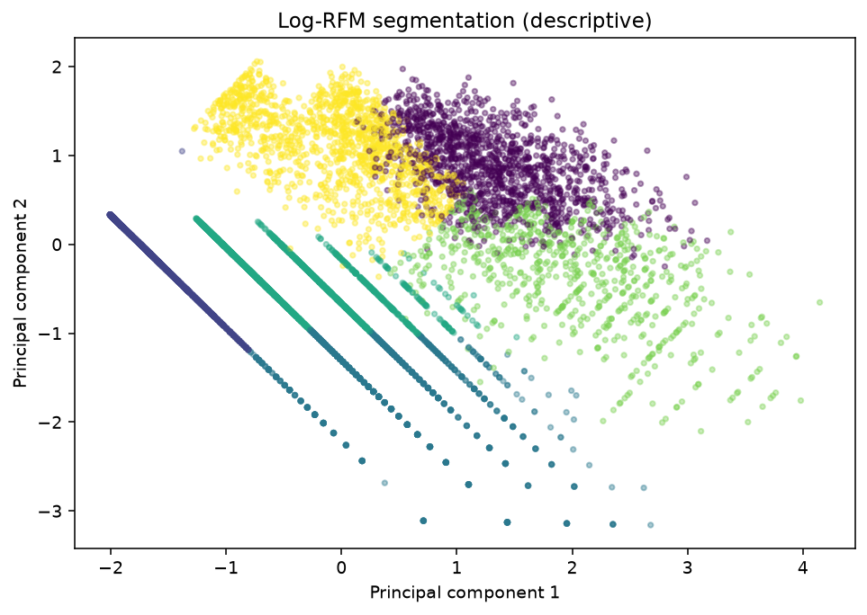
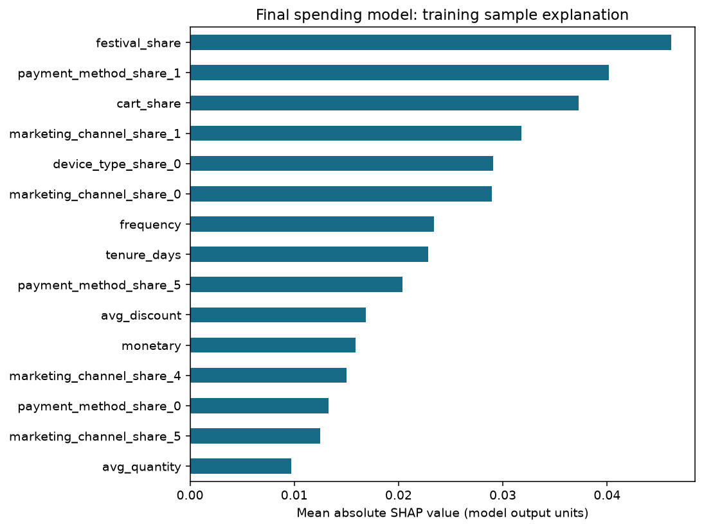
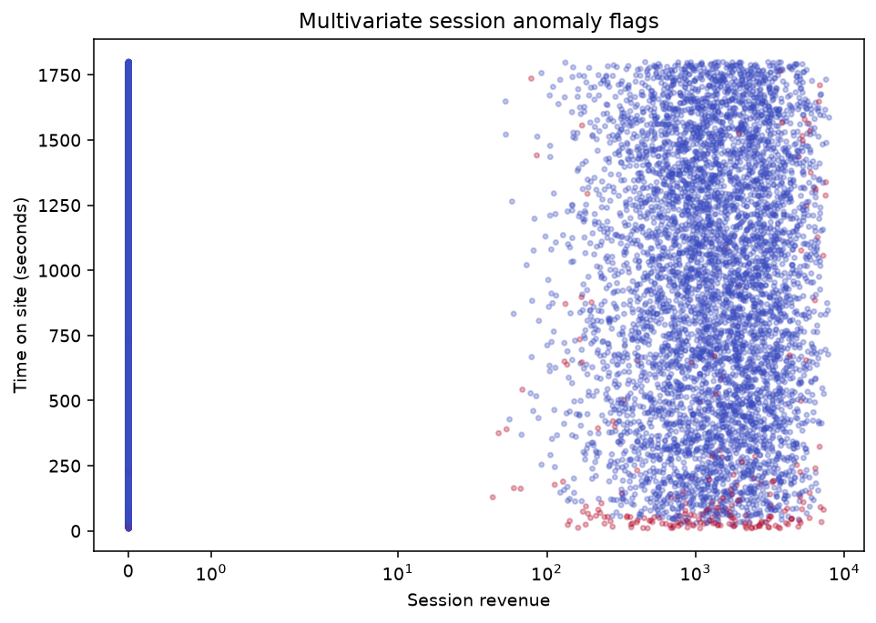

NATIONAL INSTITUTE OF TECHNOLOGY SIKKIM

# Customer Segmentation and E-Commerce Mining

Customer Segmentation
and E-Commerce Mining

Data Warehouse and Mining Laboratory (AI14201 / CS14211)

Submitted by **Chaitanya Kashyap (B240006AI)** and **Aditya (B240030CS)**.

Submitted to **Dr. Krishna Kumar, Assistant Professor**, Department of Computer Science and Engineering.

### Abstract

This project builds a SQLite session warehouse and evaluates future spending class, future session inactivity and next-period revenue. A fixed customer holdout and training-only cross-validation separate model selection from final evaluation. Descriptive mining uses log-transformed RFM and multivariate session anomaly detection.

The audit exposed arbitrary row-order tie breaking in spending labels, unsupported historical claims and a same-period revenue target. This revision uses declared future-revenue bands, a fully observed 90-day inactivity horizon, and a next-90-day revenue target. These changes make old and new scores non-comparable.

The resulting predictive evidence is weak. Spending macro-F1 is only slightly above a majority baseline, churn ranking is weak, and lower revenue MAE than a mean baseline is explained by zero-heavy outcomes. A broader training-only nested-validation search did not establish a stronger model. The contribution is an auditable pipeline and an honest assessment of its limits.

| Scope | Evidence |
| --- | --- |
| Data | 25,000 sessions; 14,214 catalogue rows; 7,875 eligible customers |
| Feature cutoff | 2024-09-30 |
| Outcome horizon end | 2024-12-29 |
| Reporting rule | Every reported model score comes from a saved notebook output. |

<!-- pagebreak -->

## 1. Data architecture and ETL

The repository retains two notebooks: notebook 01 validates and loads sources; notebook 02 performs modelling and descriptive mining. The supplied workbook is retained but is not joined because a shared customer identifier is undocumented.

| Source | Verified use |
| --- | --- |
| Ecommerce.csv | 25,000 session records with dates, revenue, device, payment, channel, category and interaction attributes. |
| Fashion Dataset v2.csv | 14,214 catalogue rows. Category-level price and rating aggregates provide metadata proxies. |
| Online Shopping Behavior Dataset.xlsx | Retained unchanged; not used for modelling or unsupported customer-level joins. |

### Star-schema tables

| Table | Grain / role |
| --- | --- |
| fact_sessions | One row per session; all 25,000 sessions are retained. |
| dim_customer | Source customer identifiers; no fabricated slowly changing history. |
| dim_geography | Undocumented source location codes, without invented Indian states. |
| dim_festival | Manual 2024 festival windows; first matching window wins on overlap. |
| dim_fashion_style | Category price/rating metadata and proxy coverage. |
| mart_multimodal_customers | One row per eligible customer; past predictors and separately named future outcomes. |

### Time window and outcomes

Past features use visits on or before 30 September 2024. Outcomes use visits after that cutoff through 29 December 2024 inclusive, a 90-day horizon. Customers first seen after the cutoff do not enter the modelling population. The final source date outside the horizon is excluded from labels.

| Spending band | Future revenue rule | Customers |
| --- | --- | --- |
| Low | Exactly zero | 6778 |
| Medium | Positive and at most 1,000 | 394 |
| High | Above 1,000 | 703 |

These fixed bands are illustrative, not business-validated thresholds; the source currency is undocumented. Identical future revenue receives identical labels, unlike the old row-order ranking rule.

<!-- pagebreak -->

## 2. Feature design and evaluation protocol

### Customer split

A seed-42 stratified split is fixed before any initial model fit: 6,300 training and 1,575 test customers, with no customer overlap. The same customer partition is reused for spending, churn and revenue. Spending stratification does not imply separate churn stratification of the outer holdout.

| Partition | Low | Medium | High | Total |
| --- | --- | --- | --- | --- |
| Train | 5,423 | 315 | 562 | 6,300 |
| Test | 1,355 | 79 | 141 | 1,575 |

### Predictor groups

| Group | Features and rationale |
| --- | --- |
| RFM | Recency, distinct session frequency and past monetary sum. Past spending is allowed because the target is future revenue. |
| Behaviour | Session count; average/median unit price; quantity; device, channel, payment and category shares; festival share; tenure; visit intervals; purchase/cart shares and discounts. |
| Catalogue proxies | Observed-category-weighted catalogue price, average rating, normalised price and coverage. No images are processed. |
| Further validation | Recent 30/60/90/180-day counts and spending, trends, purchase timing, last-session attributes and calendar summaries. The expanded set has 99 predictors. |

### Leakage controls

Future monetary, future session count, churn, class labels and customer IDs are excluded from predictors. Features use past visits only. A perturbation of future revenue, unit price and device data must leave every past feature unchanged. Source keys, nonnegative values, dimension coverage and SQLite integrity are checked.

Initial model selection uses five-fold training CV. Median imputation, scaling and optional SMOTE occur inside each fold. XGBoost sample weights are recomputed on the fold training labels; LightGBM class weights are fold-local. Randomised searches maximise macro-F1 for spending. No held-out threshold, feature or model selection occurs.

After all initial supervised selections are locked, each prespecified estimator is evaluated in one final test stage. Later figures and error inspection use cached predictions. Further development uses nested validation on original training customers only, with hashes proving that original test outputs remain unchanged.

### Selection budgets

Each spending tree family/imbalance approach samples four configurations, and logistic regression samples three. Cross-validation runs sequentially.

<!-- pagebreak -->

## 3. Spending prediction and ablation

Training CV selected XGBoost with SMOTE and RFM + behavioural + catalogue-proxy features. Each ablation selects its own estimator using the same candidate families and search budget; the comparison therefore measures modelling recipes rather than a causal proxy effect.

| Recipe / baseline | Accuracy | Balanced accuracy | Macro-F1 | Low recall | Medium recall | High recall |
| --- | --- | --- | --- | --- | --- | --- |
| Majority baseline | 0.860317 | 0.333333 | 0.308305 | 1.000000 | 0.000000 | 0.000000 |
| Logistic regression baseline | 0.860317 | 0.333333 | 0.308305 | 1.000000 | 0.000000 | 0.000000 |
| RFM | 0.860317 | 0.333333 | 0.308305 | 1.000000 | 0.000000 | 0.000000 |
| RFM + behaviour | 0.719365 | 0.310229 | 0.311916 | 0.825830 | 0.012658 | 0.092199 |
| RFM + behaviour + proxies | 0.707302 | 0.319593 | 0.320110 | 0.808856 | 0.050633 | 0.099291 |

Scores above are final held-out results. The selected model raises macro-F1 slightly above the majority baseline while losing accuracy and balanced accuracy. It recalls few Medium or High customers; the evidence does not support strong targeting performance.

The 14 Medium customers predicted High are an error cohort, not validated aspirational prospects. No in-sample marketing target list is produced. The unsupported fixed +6% visual improvement claim is replaced by the measured ablation above.

Source: outputs/spending_test_metrics.csv and outputs/spending_confusion_matrix.csv.

<!-- pagebreak -->

## 4. Future inactivity and revenue prediction

### Churn: no session in the next 90 days

The old churn rule, recency above 90 days, is replaced with absence of sessions in the future horizon. Logistic regression and random forest are compared by training-CV average precision. Logistic regression wins that selection. The original test decision threshold remains 0.5; PR-AUC here means average precision.

| Model / baseline | ROC-AUC | PR-AUC (AP) | Churn F1 | Accuracy | Macro-F1 |
| --- | --- | --- | --- | --- | --- |
| Prior baseline | 0.500000 | 0.514286 | 0.000000 | 0.485714 | 0.326923 |
| Logistic regression | 0.471185 | 0.492620 | 0.500311 | 0.490159 | 0.489948 |

The model ranks worse than the constant-score baseline on this holdout. The prior baseline uses training prevalence; at 0.5 it predicts the active class, so its zero churn F1 is a weak F1 reference. The later nested analysis adds an always-churn reference. Session absence is not confirmed account closure.

### CLV proxy: next-90-day revenue

Past features predict future monetary revenue, rather than explaining the same-period monetary column. Linear regression and raw/log1p-target histogram gradient boosting are compared by training-CV MAE on the original revenue scale. The log-target model is selected; inverse predictions use expm1 without a smearing correction.

| Model / baseline | R-squared | MAE |
| --- | --- | --- |
| Mean baseline | -0.000077 | 454.987265 |
| Linear regression | -0.011268 | 457.160529 |
| Gradient boosting / raw target | -0.009499 | 455.653103 |
| Gradient boosting / log1p | -0.095658 | 261.689656 |

The selected model improves MAE relative to a mean predictor, but its negative R-squared indicates weak squared-error forecasting. With mostly zero outcomes, a near-zero estimate can improve MAE without learning useful revenue separation. The nested analysis tests this against a median constant. This target is not discounted lifetime value.

Sources: outputs/churn_test_metrics.csv and outputs/clv_test_metrics.csv.

<!-- pagebreak -->

## 5. Additional training-only validation

After the original holdout was opened, a second round explored stronger models without reopening it. Three outer folds assess a procedure with five inner folds. All customers in this extension belong to the original training partition. Estimates remain exploratory because algorithm development has already used this population; a new future period is still required.

### Spending: richer features and decision weighting

Compare logistic regression, Extra Trees, histogram boosting, CatBoost at two depths, and the original fixed XGBoost recipe. Inner out-of-fold probabilities choose the candidate and class multipliers by macro-F1. Each locked choice is evaluated once on its outer fold. Multipliers are decision weights, not calibrated probabilities.

| Procedure / reference | Mean macro-F1 | Fold std | Mean accuracy | Mean balanced accuracy |
| --- | --- | --- | --- | --- |
| Majority baseline | 0.308397 | 0.000053 | 0.860794 | 0.333333 |
| Nested selected procedure | 0.316990 | 0.001800 | 0.785556 | 0.325481 |
| Original fixed recipe | 0.330954 | 0.015348 | 0.691111 | 0.336218 |

The broader selection does not outperform the original recipe on these outer folds. That recipe was previously chosen using the full training set, so it is an exploratory reference, not an independently selected nested competitor. Inner full-training selection is optimistic and does not justify promoting a new model.

### Churn: ranking and threshold selection

| Procedure / reference | Mean ROC-AUC | Mean PR-AUC (AP) | Mean churn F1 |
| --- | --- | --- | --- |
| Always churn reference | 0.500000 | 0.499841 | 0.666526 |
| Nested selected procedure | 0.505205 | 0.500749 | 0.666384 |

Ranking remains near chance. Threshold tuning produces approximately the always-churn reference F1, rather than meaningful customer separation.

### Revenue: test the median reference

| Procedure / reference | Mean R-squared | Mean MAE |
| --- | --- | --- |
| Mean baseline | -0.000307 | 461.970898 |
| Median baseline | -0.088537 | 267.732483 |
| Nested selected procedure | -0.088537 | 267.732483 |

The training-median constant wins inner selection in every outer fold. Extra modelling did not beat this simple reference. These validation means must not be subtracted from held-out scores to claim an improvement.

<!-- pagebreak -->

## 6. Log-RFM customer segmentation

Recency, frequency and monetary are log1p-transformed and standardised before K-Means. K is selected from 2 through 6 using the highest silhouette on a fixed sample of up to 2,000 customers. Davies-Bouldin and inertia are diagnostics. Gaussian-mixture BIC is a separate model-family diagnostic, not a K-Means score.

| K | Silhouette | Davies-Bouldin | GMM BIC |
| --- | --- | --- | --- |
| 2.000000 | 0.389507 | 1.161009 | 10266.767977 |
| 3.000000 | 0.373690 | 1.072131 | 4982.567194 |
| 4.000000 | 0.377325 | 1.021710 | -8631.769322 |
| 5.000000 | 0.391887 | 0.957688 | -8620.474077 |
| 6.000000 | 0.407408 | 0.914251 | -22682.417514 |

### Selected segment profiles

| ID | Customers | Mean recency | Mean frequency | Mean monetary | Median monetary |
| --- | --- | --- | --- | --- | --- |
| 0 | 1360 | 75.21 | 3.84 | 2515.59 | 1953.03 |
| 1 | 1656 | 148.24 | 1.00 | 0.03 | 0.00 |
| 2 | 929 | 15.09 | 2.58 | 0.00 | 0.00 |
| 3 | 1912 | 104.31 | 2.62 | 0.00 | 0.00 |
| 4 | 716 | 10.50 | 3.23 | 2467.49 | 2042.78 |
| 5 | 1302 | 119.93 | 1.62 | 1915.66 | 1418.84 |

K=6 wins silhouette within the tested range and also has the lowest tested GMM BIC. Because the optimum is at the search boundary, it does not establish six natural or stable customer types. IDs describe past activity; labels such as VIP or sleepers are not validated business outcomes.

<!-- pagebreak -->

## 7. Explainability and model interpretation

SHAP explains the locked initial spending classifier on a deterministic sample of 150 training customers. Imputation and scaling use the fitted training pipeline. The explanation never selects features from test outcomes. Tree models use TreeExplainer; linear models use LinearExplainer if selected.

The displayed predictors describe how this particular fitted model uses its inputs. A high attribution does not show causation, predictive reliability, campaign lift or customer intent. The weak held-out metrics remain the main evidence of utility.

Catalogue price, average rating and normalised price are metadata aggregates, weighted by past category preferences. The category mapping is assumed, product joins are unverified, and missing categories are not filled with future session statistics. No ResNet-50 embeddings, PyTorch image pipeline or verified visual-feature uplift is present.

Sources: outputs/spending_shap_importance.csv and the saved SHAP figure from notebook 02.

<!-- pagebreak -->

## 8. Multivariate session anomalies and limitations

Isolation Forest uses log1p revenue, unit price, quantity, pages viewed, time on site and discount percentage. It is fitted descriptively on all 25,000 sessions, separately from predictive modelling. Configured contamination is 0.01; 250 sessions are flagged.

Flags are statistical unusualness under a specified detector. The chosen contamination controls the approximate flag rate; it is not detection accuracy. There are no confirmed fraud or bot labels and no claim of validated fraud detection.

### Practical limits

One cutoff cannot establish temporal generalisation. Revenue bands are illustrative, the currency is undocumented and zero outcomes dominate spending and revenue. Catalogue dates and cross-source identity are unknown. Geography codes have no verified state mapping. Festival windows are manually curated and do not support causal promotion-effect claims.

The warehouse is an educational SQLite implementation. Segment stability, model calibration, economic value and deployment performance have not been established. New verified customer/product links, stronger historical signals and a genuinely untouched future period are needed before making operational recommendations.

<!-- pagebreak -->

## 9. Corrected claims and conclusion

| Historical claim / issue | Current evidence |
| --- | --- |
| Approximately 88% churn accuracy | Unsupported. The old saved notebook printed 0.63 accuracy; the new future-inactivity results are reported with ranking metrics and baselines. |
| ResNet-50 visual embeddings | Absent. The implementation uses catalogue category-level price/rating proxies. |
| Fixed +6% visual-feature gain | Unsupported. A measured feature-group ablation replaces the claim; it does not establish causal or statistically significant uplift. |
| Old macro-F1 approximately 0.454 | The saved XGBoost macro-F1 is 0.455329; 0.454055 is balanced accuracy. |
| 14,000 catalogue products | The source contains 14,214 rows. This is not a verified cross-source product join. |
| Balanced future-spending classes | Row-order tie breaking split identical zero revenue across classes. Declared bands replace that arbitrary target. |
| Aspirational marketing targets | Medium-to-High misclassification is an error cohort, not demonstrated marketing opportunity. |
| Geographic, festival or fraud conclusions | No invented state mapping, causal festival lift or validated fraud detection is claimed. |

### Historical versus current evaluation

| Metric | Historical saved output | Current held-out output |
| --- | --- | --- |
| Spending accuracy / macro-F1 | 0.540317 / 0.455329 | 0.707302 / 0.320110 |
| Churn accuracy / macro-F1 | 0.63 / 0.60 (saved precision) | 0.490159 / 0.489948 |
| Revenue R-squared | 0.0861 | -0.095658 |

These rows are historical context, not a controlled before/after experiment. Spending labels, churn labels, revenue targets and customer splitting changed. A higher spending accuracy cannot be advertised as a genuine improvement across those different tasks.

### Conclusion

The revision delivers a reproducible warehouse, explicit future outcomes, fold-local training, auditable baselines and saved evidence. Additional model complexity did not establish a stronger predictive model. Honest limitations and a reproducible negative result are preferable to unsupported performance or business claims.

<!-- pagebreak -->

## 10. Reproduction and evidence index

The report is generated from saved notebook exports. Building it does not refit a model, reopen the test set or modify saved scores. The original report is preserved under local_notes/original_docs/ and excluded from Git. Its SHA-256 is recorded in the report manifest.

### Run the analysis

Use Python 3.12 on Windows. Create and activate a virtual environment, then install the pinned analysis environment. Run commands from the repository root.

python -m pip install -r requirements-lock.txt

python scripts/run_notebooks.py

python scripts/verify_results.py

python -m pip install -r requirements-report.txt

python scripts/build_report.py

python scripts/verify_report.py

The runner uses the current Python executable, executes both notebooks sequentially and saves outputs.

### Evidence index

| Artifact | Role |
| --- | --- |
| 01_Data_Warehouse_ETL_updated.ipynb | Source validation, temporal mart, warehouse and leakage checks. |
| 02_Multimodal_Data_Mining_updated.ipynb | Initial training selection, final test, explanations, descriptive mining and separate nested validation. |
| outputs/model_summary.json | Authoritative initial held-out model metrics. |
| outputs/additional_validation_summary.json | Training-only nested estimates and unchanged holdout hashes. |
| outputs/legacy_audit.json | Historical saved-output audit with source commit. |
| outputs/customer_split.csv | Fixed, customer-disjoint train/test partition. |
| outputs/*_test_metrics.csv | Per-model held-out scores; cached predictions support verification. |
| Project_Report.md / scripts/build_report.py | Readable report source and reproducible PDF builder. |
| outputs/report_manifest.json | Source/output hashes, numerical reporting checks and report build versions. |

Project repository: https://github.com/ChaitanyaKash/CustomerSegmentation. References in this report are repository artifacts, not claims about unverified external dataset provenance.
