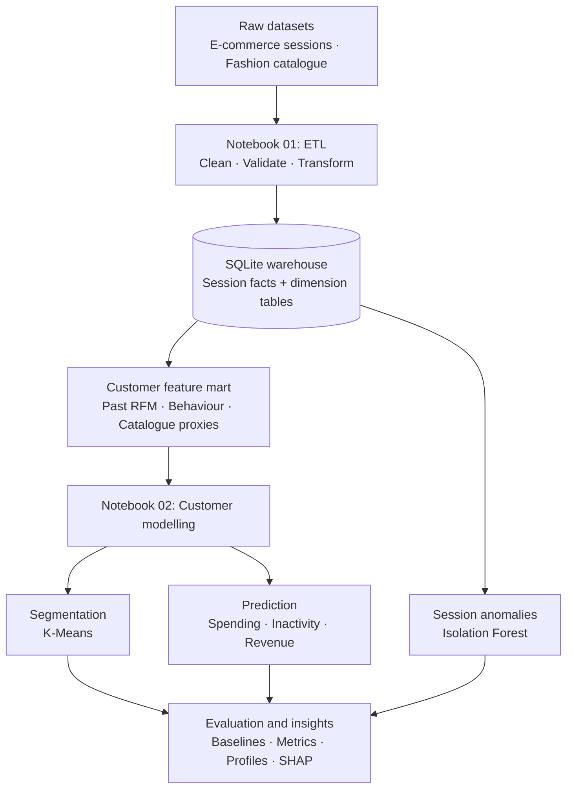

# Customer Segmentation and E-Commerce Mining

## Overview

A customer analytics project developed for the **Data Warehouse and Mining Laboratory at NIT Sikkim**. It integrates e-commerce sessions and fashion-catalogue metadata into a SQLite warehouse, builds customer features, and applies segmentation, anomaly detection and predictive modelling.

The implementation covers data validation, temporal feature engineering, customer-level evaluation, model explainability and reproducible reporting.

**Authors:** Chaitanya Kashyap (B240006AI) and Aditya (B240030CS), Department of Computer Science and Engineering, National Institute of Technology Sikkim.

## Architecture



The warehouse uses a star schema:

- `fact_sessions`: one row per session.
- `dim_customer`: customer identifiers and attributes.
- `dim_geography`: geographic attributes.
- `dim_festival`: festival-window attributes.
- `dim_fashion_style`: catalogue category metadata.
- `mart_multimodal_customers`: one row per eligible customer, with features and future outcomes.

ETL checks cover unique keys, dimension coverage, nonnegative transaction values, date boundaries and database integrity. A future-data perturbation check verifies that changing future transactions does not change past customer features.

## Datasets

| Source | Size | Purpose |
| --- | --- | --- |
| `data/raw/Ecommerce.csv` | 25,000 sessions | Customer activity, transaction attributes and outcome construction |
| `data/raw/Fashion Dataset v2.csv` | 14,214 catalogue rows | Category-level price and rating metadata |
| `mart_multimodal_customers` | 7,875 eligible customers | Customer features and future outcomes |

`Online Shopping Behavior Dataset.xlsx` is retained as a supplied source file but is not joined because a shared customer key is undocumented.

Source counts and hashes are recorded in [ETL summary](outputs/etl_summary.json).

## Methods

### Temporal feature construction

**Observation window:** sessions through 30 September 2024.

**Outcome window:** the following 90 days, ending 29 December 2024.

Customer predictors use activity available by the observation cutoff. Features include:

- Recency, session frequency and past monetary value.
- Price and quantity aggregates.
- Device, marketing-channel, payment-method and category shares.
- Festival-session share.
- Customer tenure and intervals between visits.
- Purchase and cart behaviour.
- Category-level catalogue price, average rating and normalised price.

Catalogue attributes are metadata proxies; the pipeline does not extract image embeddings.

### Modelling tasks

| Task | Target or objective | Approach |
| --- | --- | --- |
| Spending prediction | Future revenue: Low = 0, Medium = (0, 1000], High > 1000 | Logistic regression, XGBoost and LightGBM; selection by macro-F1 |
| Future inactivity | No session during the outcome window | Logistic regression and random forest; selection by average precision |
| Revenue prediction | Revenue during the outcome window | Linear regression and raw/log-target gradient boosting; selection by MAE |
| Customer segmentation | Patterns in observed RFM | Log1p transformation, standardisation and K-Means |
| Session anomalies | Unusual combinations of session attributes | Isolation Forest on six session features |

### Evaluation

A seed-42 stratified customer split creates **6,300 training customers and 1,575 test customers**.

Five-fold cross-validation on training customers selects models and hyperparameters. Imputation, scaling and SMOTE are fitted inside the training folds. Weighting and resampling are compared using the same selection metric.

Feature-group comparisons cover:

1. RFM.
2. RFM with behavioural features.
3. RFM with behavioural features and catalogue proxies.

Each group uses its own CV-selected estimator, so the comparison evaluates modelling recipes rather than isolating a causal effect of individual feature groups.

SHAP explains the selected spending model using a training-customer sample. Additional exploratory validation uses three outer and five inner folds within the training partition to compare richer features, CatBoost, Extra Trees and decision weighting.

## Results

The following metrics match printed notebook outputs and saved result exports.

### Spending prediction

Training CV selects **XGBoost with SMOTE**, using RFM, behavioural features and catalogue proxies.

| Features / baseline | Accuracy | Balanced accuracy | Macro-F1 | Low recall | Medium recall | High recall |
| --- | --- | --- | --- | --- | --- | --- |
| Majority baseline | 0.860317 | 0.333333 | 0.308305 | 1.000000 | 0.000000 | 0.000000 |
| Logistic regression baseline | 0.860317 | 0.333333 | 0.308305 | 1.000000 | 0.000000 | 0.000000 |
| RFM | 0.860317 | 0.333333 | 0.308305 | 1.000000 | 0.000000 | 0.000000 |
| RFM + behaviour | 0.719365 | 0.310229 | 0.311916 | 0.825830 | 0.012658 | 0.092199 |
| RFM + behaviour + proxies | 0.707302 | 0.319593 | 0.320110 | 0.808856 | 0.050633 | 0.099291 |

The selected model achieves a small macro-F1 improvement over the majority baseline, with lower accuracy and balanced accuracy. Medium and High recall remain low, limiting its usefulness for customer targeting.

<p align="center">
  
</p>

Rows represent actual spending classes; columns represent predicted classes. Diagonal cells show correct predictions. Off-diagonal cells show errors.

### Future inactivity

Training CV selects **logistic regression**. PR-AUC is measured as average precision.

The prior baseline assigns every customer the training prevalence. At the fixed threshold of 0.5, it predicts the active class.

| Model / baseline | ROC-AUC | PR-AUC (AP) | Churn F1 | Accuracy | Macro-F1 |
| --- | --- | --- | --- | --- | --- |
| Prior baseline | 0.500000 | 0.514286 | 0.000000 | 0.485714 | 0.326923 |
| Logistic regression | 0.471185 | 0.492620 | 0.500311 | 0.490159 | 0.489948 |

The model’s ranking performance does not exceed the constant-score baseline on test customers. The baseline’s zero churn F1 follows from its thresholded predictions and should not be interpreted as a strong F1 benchmark.

### Revenue prediction

Training CV selects **gradient boosting with a log1p target** by MAE. Predictions are evaluated in the source revenue units.

| Model / baseline | R² | MAE |
| --- | --- | --- |
| Mean baseline | -0.000077 | 454.987265 |
| Linear regression | -0.011268 | 457.160529 |
| Gradient boosting / raw target | -0.009499 | 455.653103 |
| Gradient boosting / log1p | -0.095658 | 261.689656 |

The log-target model reduces MAE against the mean baseline, while negative R² indicates weak squared-error prediction.

Because future revenue contains many zeros, a median predictor is also an important MAE reference. In nested validation, the training-median constant is selected in every outer fold, achieving mean MAE **267.732483**, matching the selected procedure.

### Additional training validation

These spending metrics are means across outer folds within the training partition. They are exploratory validation estimates, separate from test scores.

| Procedure / baseline | Mean macro-F1 | Fold std | Mean accuracy | Mean balanced accuracy |
| --- | --- | --- | --- | --- |
| Majority baseline | 0.308397 | 0.000053 | 0.860794 | 0.333333 |
| Nested selected procedure | 0.316990 | 0.001800 | 0.785556 | 0.325481 |
| XGBoost recipe with fixed parameters | 0.330954 | 0.015348 | 0.691111 | 0.336218 |

Broader candidate selection does not outperform the fixed XGBoost recipe in this comparison. Evaluation across another time window would be needed to assess temporal generalisation.

Detailed exports:

- [Model metrics](outputs/model_summary.json)
- [Spending CV search](outputs/spending_cv_search.csv)
- [Nested validation](outputs/additional_validation_summary.json)
- [Test-customer predictions](outputs/heldout_predictions.csv)

## Insights

### Customer segments

Silhouette selection chooses **six segments** within the tested K=2–6 range. Profiles distinguish customer groups by observed recency, frequency and monetary value, including visitors with no observed revenue.

<p align="center">
  
</p>

The chart projects the transformed RFM features into two dimensions. Colours identify cluster assignments; the projection does not preserve every separation present in the full feature space.

See [segment profiles](outputs/segment_profiles.csv) and [selection diagnostics](outputs/segmentation_selection.csv).

### Session anomalies

Isolation Forest flags **250 of 25,000 sessions**, with contamination set to 0.01. These sessions are statistical review candidates; fraud or bot activity is not established.

See the [session anomaly figure](outputs/session_anomalies.png).

### Feature interpretation

SHAP summarises how customer features influence the fitted spending model’s predictions. Attribution explains model behaviour and does not establish causal relationships.

See [SHAP feature importance](outputs/spending_shap.png).

### Predictive signal

The spending distribution is dominated by zero future revenue. Accuracy alone therefore gives an incomplete view of performance. Macro-F1, balanced accuracy, class-level recall and constant baselines show that future customer behaviour remains difficult to predict from the available features.

## Limitations

- The analysis uses one observation cutoff and one 90-day outcome horizon.
- Spending bands are illustrative; currency and business-specific thresholds require validation.
- Catalogue metadata is undated and connected through an assumed category mapping rather than verified product-level joins.
- Some catalogue ratings and category coverage are missing.
- Future inactivity measures observed session absence, which may not represent permanent customer loss.
- Revenue prediction covers 90 days rather than discounted customer lifetime value.
- Festival windows are manually defined, and geographic code meanings are undocumented.
- K=6 is at the boundary of the tested clustering range; segment stability requires further assessment.
- Predictive performance is limited, and production utility or causal marketing impact has not been demonstrated.

## How to run

Use **Python 3.12** from the repository root.

`requirements.txt` contains direct dependency pins. `requirements-lock.txt` records the tested analysis environment.

```powershell
python -m venv .venv
.\.venv\Scripts\Activate.ps1
python -m pip install -r requirements-lock.txt
python scripts/run_notebooks.py
python scripts/verify_results.py
```

For interactive execution:

```powershell
jupyter notebook
```

Run the notebooks in order:

1. `01_Data_Warehouse_ETL_updated.ipynb`
2. `02_Multimodal_Data_Mining_updated.ipynb`

The result checker validates customer separation, cached metrics, notebook execution and source hashes.

Read the [project report](Project_Report.pdf) or its [Markdown version](Project_Report.md) for the methodology and analysis. Metrics, predictions, profiles and figures are stored in `outputs/`.
