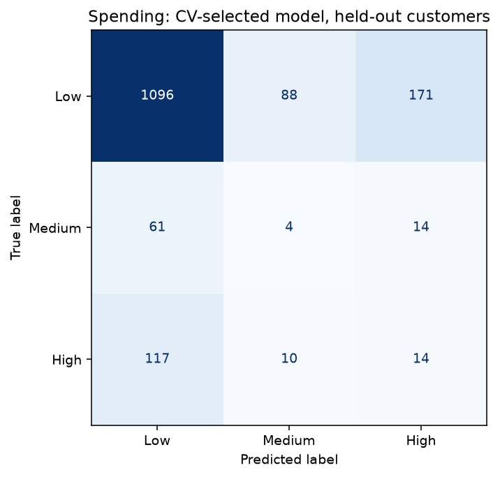

# Customer Segmentation and E-Commerce Mining

## Overview

An academic Data Warehouse & Mining Laboratory project at NIT Sikkim. The project builds a customer warehouse and evaluates spending prediction, future inactivity and next-period revenue with explicit baselines. The models have limited predictive utility on these data. This revision improves evaluation and reproducibility; it does not claim strong business performance.

Authors: **Chaitanya Kashyap (B240006AI)** and **Aditya (B240030CS)**, Department of Computer Science & Engineering, National Institute of Technology Sikkim.

## Architecture

```text
Raw session CSV + fashion catalogue CSV
                  |
01_Data_Warehouse_ETL_updated.ipynb
                  |
SQLite: fact_sessions
  -> dim_customer, dim_geography, dim_festival, dim_fashion_style
  -> mart_multimodal_customers (past features + separate future outcomes)
                  |
02_Multimodal_Data_Mining_updated.ipynb
  -> train-only selection -> one final customer holdout evaluation
  -> descriptive segmentation/anomalies
  -> separate training-only nested-validation extension
                  |
outputs/: printed-metric exports, split manifest, diagnostics and figures
```

The ETL validates keys, dimension coverage, nonnegative transaction values, outcome-horizon coverage and SQLite integrity. A future-data perturbation test confirms that future changes cannot affect past predictors. Geography retains undocumented source location codes; no Indian city/state assignments are invented.

## Datasets

| Local source | Verified size / use |
| --- | --- |
| `data/raw/Ecommerce.csv` | 25,000 session rows; past activity and future outcomes |
| `data/raw/Fashion Dataset v2.csv` | 14,214 catalogue rows; category-level price/rating proxies |
| `data/raw/Online Shopping Behavior Dataset.xlsx` | Preserved, unused: no documented cross-source customer key |
| `mart_multimodal_customers` | 7,875 customers observed by the cutoff |

Source hashes and counts are printed in notebook 01 and saved in [`outputs/etl_summary.json`](outputs/etl_summary.json). Category codes follow the original project's assumed mapping. Catalogue product IDs are not verified session product matches. Missing proxy categories remain missing until fold-local imputation; future transactions never backfill them.

## Methods

Features use sessions through **2024-09-30**. Outcomes use the following **90 days**, ending **2024-12-29**. Customers first observed after the feature cutoff are excluded from modelling.

The old future-revenue target ranked ties by row order, assigning different labels to identical zero revenue. The new fixed, illustrative bands are **Low = 0**, **Medium = (0, 1000]**, **High > 1000** revenue units. Currency is undocumented and the bands need business validation. Past monetary is a valid predictor of this future target; future monetary, future session count, churn, target-derived ranks and customer IDs are excluded from predictors.

One seed-42 stratified spending split fixes **6,300 training / 1,575 test customers**, reused for all supervised tasks. Spending classes in train are **5,423 / 315 / 562** and test **1,355 / 79 / 141**, in Low/Medium/High order. All initial selection uses five-fold training CV. Each prespecified final estimator is evaluated in one held-out evaluation stage, with cached predictions for later diagnostics. No test-based model or threshold selection occurs.

- **Spending:** majority and logistic baselines; random-search XGBoost and LightGBM. Compare fold-local weighting against SMOTE inside an imbalanced-learn pipeline, scoring macro-F1. Every ablation receives the same candidate families and search budget. Behaviour includes session count, price and quantity aggregates, device/channel/payment/category shares, festival share, tenure, visit gaps, purchase/cart behaviour and discount information. Imputation and scaling are fitted inside each training fold. SHAP explains the locked spending model on training customers.
- **Churn:** no session in the next 90 days. Compare logistic regression and random forest by training-CV average precision. Keep the probability threshold fixed at 0.5 for the original test. PR-AUC is reported as **average precision**, not trapezoidal integration.
- **CLV proxy:** next-90-day revenue, compared with a mean baseline. Evaluate linear regression and raw/log-target gradient boosting; select by training-CV MAE on the original scale. This is not discounted lifetime value.
- **Segmentation:** log1p RFM, standardisation, K-Means selection over K=2–6 by sampled silhouette; Davies–Bouldin/inertia diagnostics and a separate GMM BIC table. No cluster labels enter supervised models.
- **Anomalies:** Isolation Forest on revenue, unit price, quantity, pages, time on site and discount percentage. The configured contamination rate controls flag frequency; there are no verified fraud labels.
- **Further improvement round:** richer recent-window/trend features, CatBoost, Extra Trees and probability-decision weighting. Three outer folds assess selection with five inner folds on **original training customers only**. Churn and revenue also receive nested validation with explicit constant references. This extension never reopens the original holdout; its results are validation estimates, not new test scores. Inner selection scores are optimistic and are not promoted as generalisation estimates.

## Results

All entries below are printed in the saved notebooks. Machine-readable sources are [`outputs/model_summary.json`](outputs/model_summary.json), [`outputs/additional_validation_summary.json`](outputs/additional_validation_summary.json) and the corresponding CSV files. Values are rounded to six decimal places.

### Original final held-out spending evaluation

CV selected **XGBoost / SMOTE**, using **RFM + behaviour + proxies**. Each ablation uses its own CV-selected model, so this compares modelling recipes rather than isolating a causal effect of proxy features.

| Recipe / baseline | Accuracy | Balanced accuracy | Macro-F1 | Low recall | Medium recall | High recall |
| --- | --- | --- | --- | --- | --- | --- |
| Majority baseline | 0.860317 | 0.333333 | 0.308305 | 1.000000 | 0.000000 | 0.000000 |
| Logistic regression baseline | 0.860317 | 0.333333 | 0.308305 | 1.000000 | 0.000000 | 0.000000 |
| RFM | 0.860317 | 0.333333 | 0.308305 | 1.000000 | 0.000000 | 0.000000 |
| RFM + behaviour | 0.719365 | 0.310229 | 0.311916 | 0.825830 | 0.012658 | 0.092199 |
| RFM + behaviour + proxies | 0.707302 | 0.319593 | 0.320110 | 0.808856 | 0.050633 | 0.099291 |

The selected model has slightly higher macro-F1 than the majority baseline, lower accuracy and lower balanced accuracy. Minority-class recall remains poor. The old +6% claim is unsupported. The initial training CV table is in [`outputs/spending_cv_search.csv`](outputs/spending_cv_search.csv).



### Original final held-out churn evaluation

CV selected **Logistic regression**. The prior baseline returns the training prevalence; at the fixed threshold it predicts the active class. Its zero churn F1 is not a strong F1 benchmark. Ranking metrics below show that this churn model does not outperform a constant-score baseline. The later nested validation includes an always-churn reference.

| Model / baseline | ROC-AUC | PR-AUC (AP) | Churn F1 | Accuracy | Macro-F1 |
| --- | --- | --- | --- | --- | --- |
| Prior baseline | 0.500000 | 0.514286 | 0.000000 | 0.485714 | 0.326923 |
| Logistic regression | 0.471185 | 0.492620 | 0.500311 | 0.490159 | 0.489948 |

### Original final held-out next-period revenue evaluation

CV selected **Gradient boosting / log1p** by MAE. Lower MAE than a mean predictor does not establish useful revenue discrimination: the selected model has negative R² on the zero-heavy target. The later nested validation includes a stronger median reference for MAE.

| Model / baseline | R² | MAE |
| --- | --- | --- |
| Mean baseline | -0.000077 | 454.987265 |
| Linear regression | -0.011268 | 457.160529 |
| Gradient boosting / raw target | -0.009499 | 455.653103 |
| Gradient boosting / log1p | -0.095658 | 261.689656 |

### Additional training-only nested validation

These are means across outer validation folds, using a different evaluation procedure from the holdout tables. Do not subtract them from held-out scores to claim an improvement. Spending fold standard deviation is descriptive, not a confidence interval. The original fixed recipe's configuration had already been chosen on the full training set, so it is an exploratory reference rather than an independently selected nested competitor.

**Spending**

| Procedure / reference | Mean macro-F1 | Fold std | Mean accuracy | Mean balanced accuracy | Mean Medium recall | Mean High recall |
| --- | --- | --- | --- | --- | --- | --- |
| Majority baseline | 0.308397 | 0.000053 | 0.860794 | 0.333333 | 0.000000 | 0.000000 |
| Nested selected procedure | 0.316990 | 0.001800 | 0.785556 | 0.325481 | 0.025397 | 0.044525 |
| Original fixed recipe | 0.330954 | 0.015348 | 0.691111 | 0.336218 | 0.101587 | 0.122815 |

The broader selection procedure did not outperform the original fixed recipe on these outer folds. No stronger spending model is promoted from this extension. The candidate chosen by full-training OOF selection remains exploratory.

**Churn**

| Procedure / reference | Mean ROC-AUC | Mean PR-AUC (AP) | Mean churn F1 |
| --- | --- | --- | --- |
| Always churn reference | 0.500000 | 0.499841 | 0.666526 |
| Nested selected procedure | 0.505205 | 0.500749 | 0.666384 |

Churn ranking remains near chance. The tuned churn F1 is essentially the always-churn reference; a larger F1 here does not demonstrate better customer discrimination.

**Next-period revenue**

| Procedure / reference | Mean R² | Mean MAE |
| --- | --- | --- |
| Mean baseline | -0.000307 | 461.970898 |
| Median baseline | -0.088537 | 267.732483 |
| Nested selected procedure | -0.088537 | 267.732483 |

The revenue procedure chose the training-median constant in every outer fold. Its lower MAE relative to the mean baseline is a property of this zero-heavy target, not a successful learned revenue forecast.

### Historical context and corrected claims

The prior saved outputs are preserved in [`outputs/legacy_audit.json`](outputs/legacy_audit.json), with their source commit, and printed in notebook 02. Target definitions, splits and evaluation procedures changed, so this is **not a controlled before/after performance comparison**.

| Metric | Historical saved output | New held-out output | Why scores are not directly comparable |
| --- | --- | --- | --- |
| Spending accuracy / macro-F1 | 0.540317 / 0.455329 | 0.707302 / 0.320110 | Fixed revenue bands replace row-order ranks |
| Spending majority accuracy / macro-F1 | 0.497143 / 0.221374 | 0.860317 / 0.308305 | Different class distribution; historical baseline derived from saved counts |
| Churn accuracy / macro-F1 | 0.63 / 0.60 (saved precision) | 0.490159 / 0.489948 | Future no-session label replaces recency rule |
| Revenue R² | 0.0861 | -0.095658 | Future revenue replaces same-period monetary |

- Removed the unsupported approximately 88% churn claim; the old saved notebook reported 0.63 accuracy, and the new future-inactivity results are reported separately.
- Removed the ResNet-50 claim: price, average rating and normalised price are catalogue category proxies. No image embeddings are extracted.
- Replaced the unsupported +6% visual uplift with a measured ablation; it does not establish a causal or statistically significant improvement.
- Corrected the old XGBoost macro-F1 to 0.455329; 0.454055 was balanced accuracy.
- Corrected catalogue size to 14,214 rows and distinguished sessions from eligible customers.
- Replaced row-order splitting of identical zero-revenue outcomes with declared revenue bands.
- Removed simulated-state spending conclusions and unverified fraud/bot claims.
- Replaced the in-sample “aspirational customer” list with a clearly labelled held-out error cohort. Misclassification is not demonstrated marketing opportunity.
- Replaced the public PDF with a revised report based on saved results; the unchanged historical PDF remains backed up locally outside Git.

## Insights

Spending prediction is dominated by zero future revenue; always report macro-F1 and the majority baseline alongside accuracy. Behavioural aggregates provide little evidence of strong future spending separation in the initial held-out results. Churn is weak by ROC-AUC and average precision. Revenue MAE must be compared against both mean and median constants because of zero inflation.

Descriptive K selection chose **6 segments** within the tested range; profiles and full diagnostics are in [`outputs/segment_profiles.csv`](outputs/segment_profiles.csv) and [`outputs/segmentation_selection.csv`](outputs/segmentation_selection.csv). The best K is at the search boundary, so these are not definitive natural customer types. Isolation Forest flagged **250 sessions** under its configured contamination; this is not validated fraud detection.

There are **14 held-out Medium customers predicted High**, an error cohort rather than verified aspirational prospects. No in-sample marketing target list is published.

## Limitations

This is one historical cutoff and one observation horizon. A new, untouched future period is needed to confirm gains from further development. The fixed revenue bands are illustrative and alter the old task. Nested CV still uses the original development population; it cannot establish temporal generalisation.

The catalogue is undated, has substantial missing ratings, and is connected through an assumed category mapping. Proxies are not genuine visual features or demonstrated purchase-level joins. Geography codes are undocumented. Festival windows are manually curated and their associations do not establish campaign effects. Session absence is not confirmed account churn, and next-period revenue is not lifetime value. No causal marketing lift, fraud accuracy or deployment readiness is established.

[`Project_Report.pdf`](Project_Report.pdf) is the revised 11-page report, with readable source in [`Project_Report.md`](Project_Report.md). It includes the actual held-out results, baselines, additional validation and corrected claims. The unchanged historical report remains at `local_notes/original_docs/Project_Report.pdf`, excluded from Git. Slides were not present in the repository and their location is still required.

## How to run

Tested with **Python 3.12 on Windows**. Direct dependencies are pinned in `requirements.txt`; `requirements-lock.txt` records the complete executed environment. Run from the repository root:

```powershell
python -m venv .venv
.\.venv\Scripts\Activate.ps1
python -m pip install -r requirements-lock.txt
python scripts/run_notebooks.py
python scripts/verify_results.py
python -m pip install -r requirements-report.txt
python scripts/build_report.py
python scripts/verify_report.py
```

For interactive use, run `jupyter notebook` and execute notebook 01 followed by notebook 02 in this environment. The runner uses the current Python executable and saves outputs. The original modelling stage and the additional nested-validation stage can take several minutes.

The verification script refits no models. It checks execution completeness, customer separation, cached metrics, source hashes, unchanged original evaluation files and the preserved report. Output files replace obsolete charts and stray files; original generated files are backed up locally outside Git.

The report builder uses saved results only. Its manifest records the PDF, Markdown and source hashes; the report verifier checks all 74 unique tabulated numeric values. The final rendered PDF pages were visually reviewed. Rebuilding the report does not retrain models.
